## Treffpunkt: Bahnhofshalle Almaty 2
Wie besucht man jemanden, der längere Zeit auf Reisen ist? Man begibt sich selbst auf Reisen. 😊 So hieß es Koffer packen und ab nach Almaty, die größte Stadt Kasachstans im Südosten des Landes. Der Plan für die gemeinsamen 10 Tage war zunächst 3 Tage in Almaty zu verbringen, dann aufgrund der besseren Logistik für 3 Tage raus in die Natur zu fahren und die verbleibenden Tage spontan nach Lust und Laune hier oder dort zu verbringen. 

Verabredet waren wir am Bahnhof Almatys, wo Felix und Sandrine per Nachtzug aus Usbekistan ankommen sollten. Kein Problem, der Bus vom Flughafen würde durchfahren. Ich saß also im Bus, beobachtete Land und Leute und wartete auf die richtige Station zum Aussteigen. Bis es mir seltsam lange vorkam und ich erkannte, dass ich die Station verpasst haben musste. Dass es im Bus keine Anzeige gab, hatte mich anfangs wenig beunruhigt; bin ich doch davon ausgegangen, dass man den Bahnhof schon als solchen erkennen würde. Mit Schienen, großem Bahnhofsgebäude, einem Busbahnhof auf dem Vorplatz, dass die Haltestelle wie der Bahnhof heißen würde und bestimmt die Endhaltestelle wäre. Ich musste mir eingestehen, dass es schneller ging als erwartet und sämtliche für selbstverständlich gehaltene Annahmen ins Leere liefen. Kurz: meine Brunnenfrosch-Perspektive bereits am ersten Morgen ordentlich auf den Kopf gestellt wurde. Doch halb so wild, einen Buswechsel und ein paar SMS später haben wir uns schließlich gefunden.


  
  


Es gab viel zu erzählen und so zogen wir erstmal los und erkundeten ganz nebenbei Almaty, Kasachstans ehemalige Hauptstadt (heute: Astana). Zu sehen gibt’s bunte orthodoxe Kirchen, gigantisch anmutende Mahnmale und Regierungsgebäude sowie große, neu angelegte Parks mit Schaukelbänken (hängen an Ketten und haben dafür keine Füße). Das Stadtbild wirkt nüchtern funktional, überraschend grün, mit breiten, langen Straßen und vielen neuen Gebäuden. Die Straßen sind, ähnlich wie in Mannheim, schachbrettartig angelegt und gut mit Autos und Bussen gefüllt, die wiederum hoffnungslos überfüllt sein können (deutsche U-Bahn ist nichts dagegen :D). Was wirklich nett ist, sind die ausgemusterten LKW, Busse und Autos aus Europa, die man recht viel rumfahren sieht (und bei uns sicherlich keinen TüV mehr bekommen würden 😉). Anschnallen muss sich wohl generell nur der Fahrer des Autos, wobei auch das eher als Empfehlung verstanden und nur bei nahender Polizeikontrolle beherzigt wird. Auch ein sich spinnennetzartig ausbreitender Steinschlag auf der Windschutzscheibe ist noch längst kein Grund, die Werkstatt aufzusuchen. Fährt ja schließlich noch. Das Leben wirkt einfacher und unkomplizierter; Deutschland im Vergleich überreguliert. Auf der anderen Seite sind wir natürlich froh, wie Sandrine feststellte, darauf vertrauen zu können, dass die Statik eines Hauses z. B. die Last auch sicher hält.

Almaty wirkt wie eine schnell wachsende, junge Großstadt im Aufbau. Überall wird gebaut. So wird beispielsweise gerade ein Tramnetz zur Entlastung der Straßen hochgezogen und ganze Wohnviertel sind am Entstehen. Auffallend waren zudem die vielen Kinder und kinderreichen Familien, die bis spät in die Nacht das Stadtbild prägen und einen angenehm dynamischen, lebendigen _Vibe_ erzeugen (die Geburtenrate liegt in Kasachstan aktuell im Schnitt bei knapp 3 Kindern pro Frau, zudem wird man früher Eltern als bei uns).


  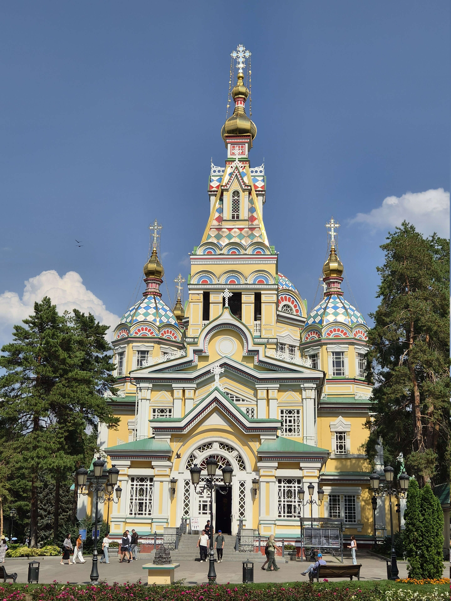
  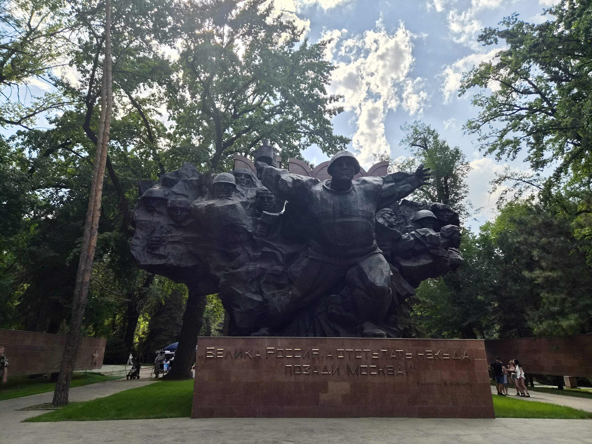
  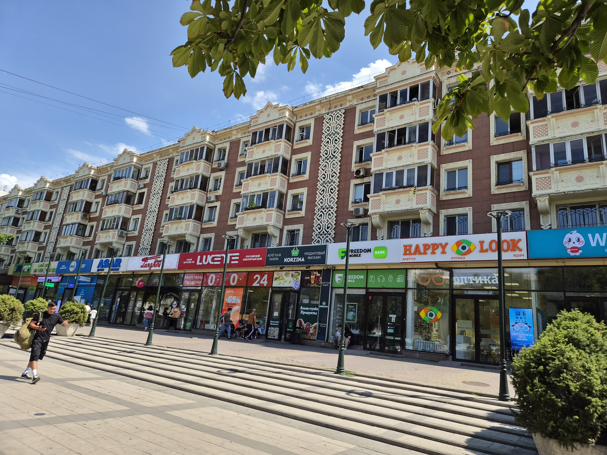
  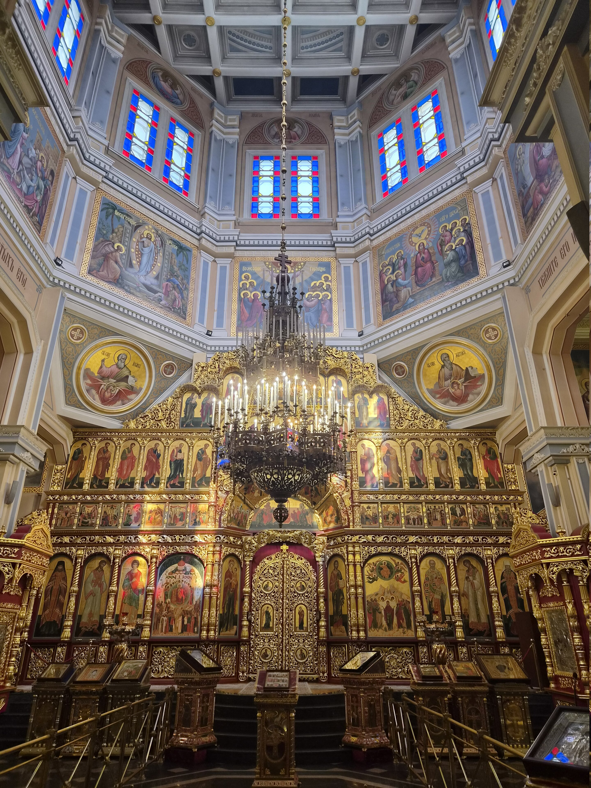
  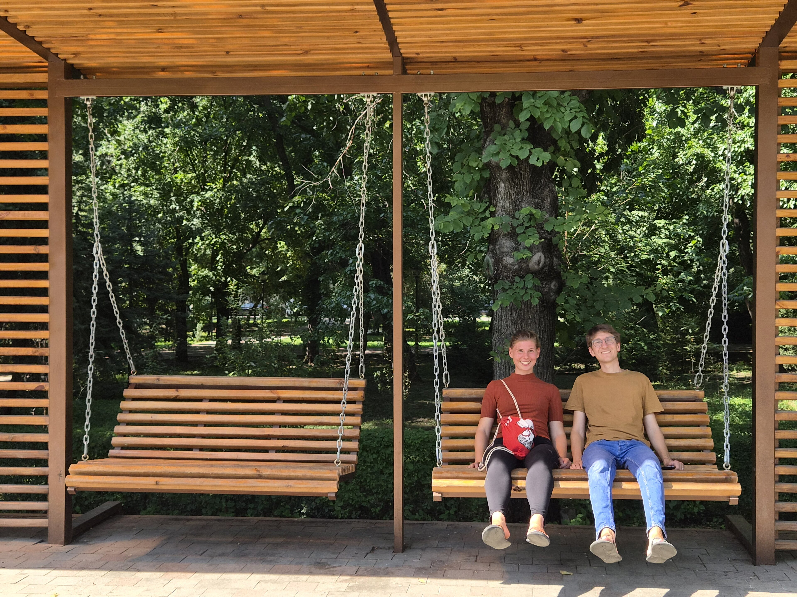
  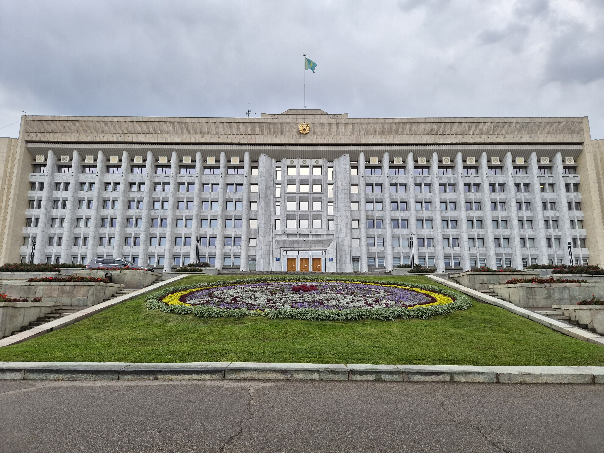
  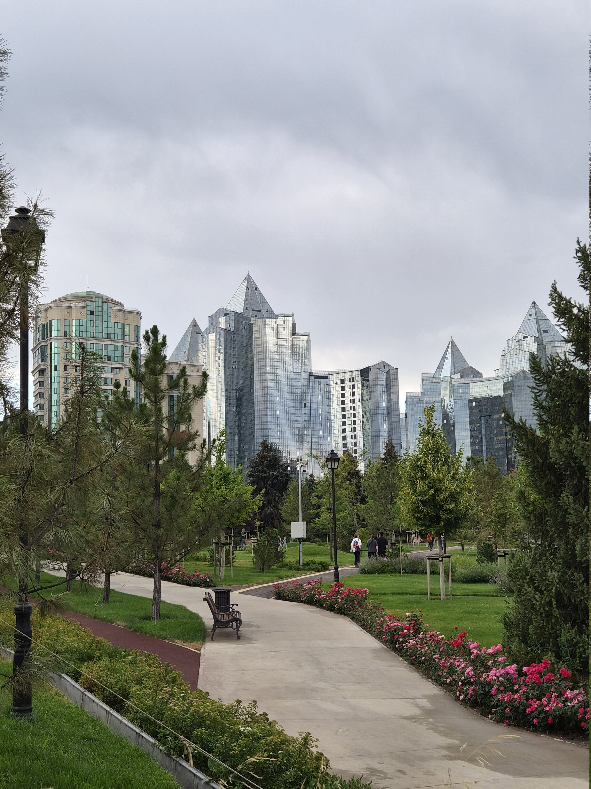
  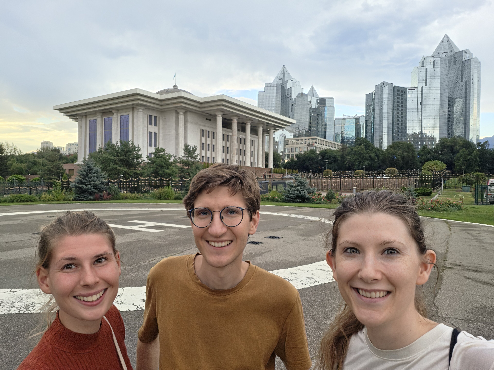
  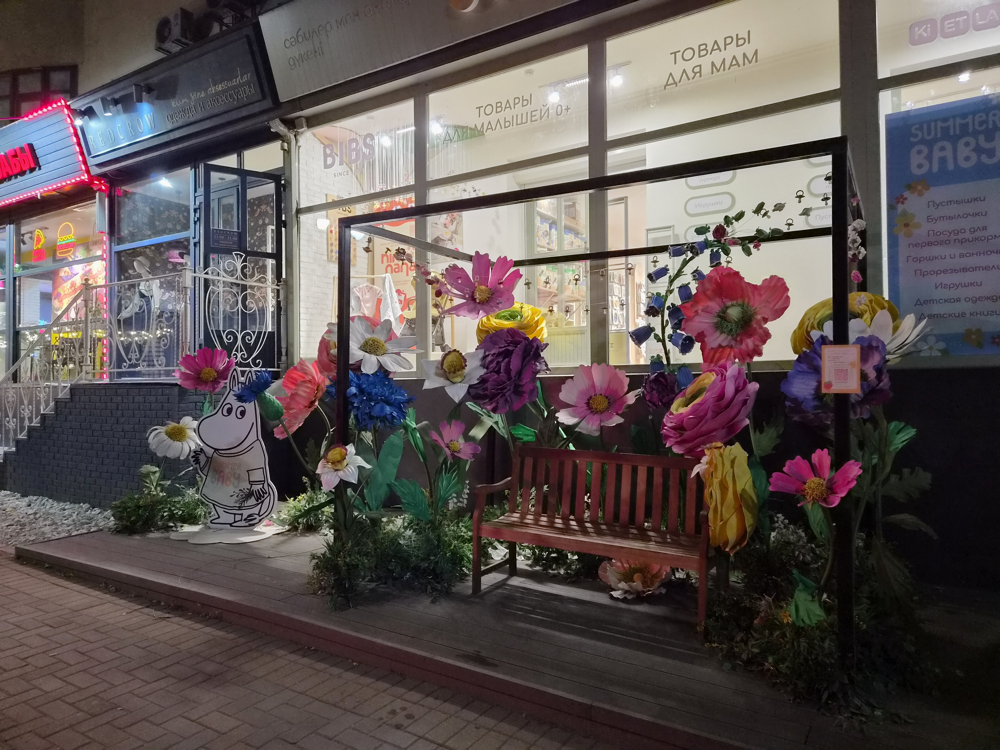


Spannend war auch das Aussehen der Menschen. Die Gesichtszüge sehen schon weitgehend chinesisch aus, während der Körperbau hingegen eher russisch/europäisch anmutet (größer als Chinesen, etwas weiter offene Augen und mehr Bart). Ein faszinierender Übergang, der zur geografischen Lage des Landes passt. Es spricht kaum jemand Englisch, doch das ändert sich wohl mit der neuen Generation, die nun erstmals Englisch statt Russisch als zweite Sprache lernt. Umso verblüffter war ich von dem erstaunlich guten Russisch, das Felix und Sandrine sich zwischenzeitlich angeeignet haben. Alles in allem haben wir die Kasachen auf unserer Reise als super gastfreundliche und unkomplizierte Menschen kennengelernt (nehmen einen z.B. viel per Anhalter mit, kaufen einem noch etwas zu trinken, sprechen einen höflich an, um kurz Hallo zu sagen und zu fragen, ob man aus Deutschland kommt,…)

Almaty ist am Fuß des Gebirges gelegen mit atemberaubender Natur drumherum. Unser erster Ausflug nach zwei Tagen Stadterkundung ging daher raus zu heißen Quellen auf über 1.800 Metern Höhe. Sommerferien- und wochenendbedingt war es sehr voll, doch nach einer wunderschönen Wanderung fanden auch wir noch Platz in den warmen Fässern (die laut Felix und Sandrine im Vergleich mit den bisher auf Reisen getesteten Quellen definitiv zu den kälteren gehörten).


  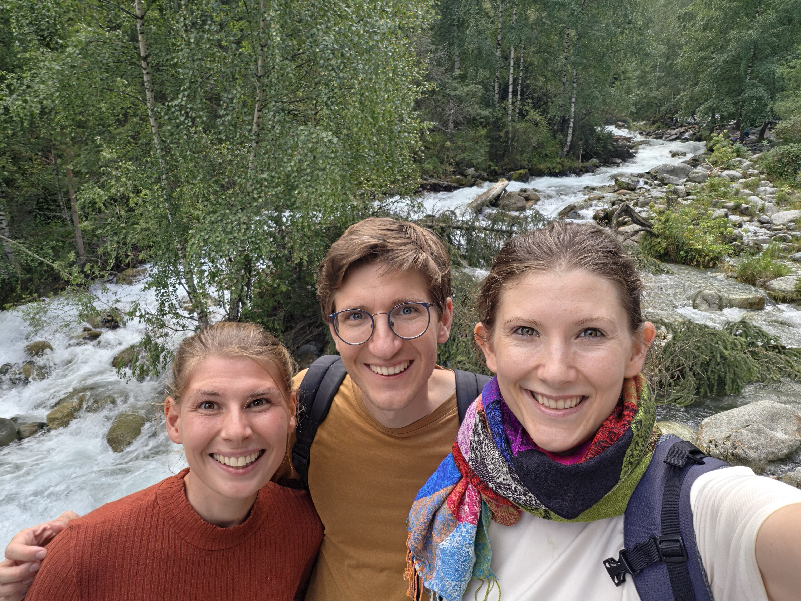
  
  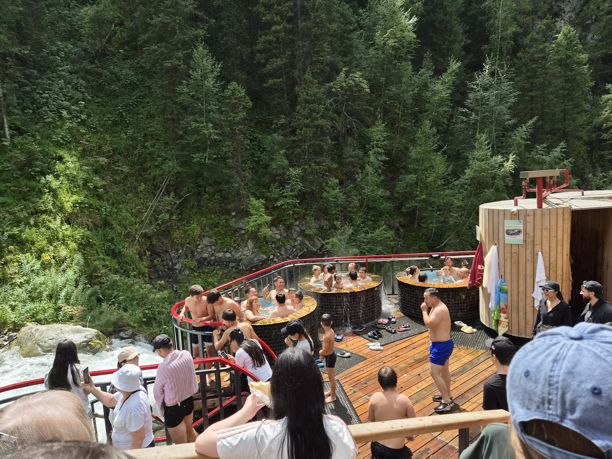
  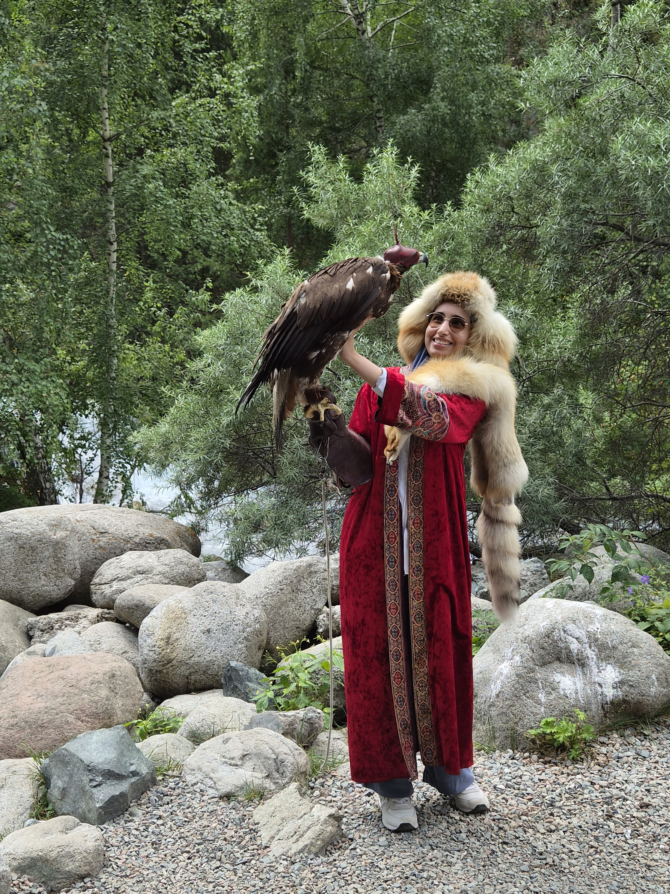
  
  
  
  
  
  
  


## Strategischer Ortswechsel
Die eigentliche Sehenswürdigkeit im Süden Kasachstans ist die Natur um Almaty herum. So schauten wir nach einem Langstreckenbus und fuhren durch herrlich karge Landschaften weiter in den Südosten aufs kasachische Land. Hier kamen wir im Gästezimmer einer Familie mit fünf jungen Töchtern unter, von denen eine wiederum bereits Mutter ist. Frühstück war zum Glück inbegriffen und Abendessen optional hinzuwählbar. Selbstversorgung wäre mangels Einkaufsgelegenheit schwierig gewesen. Für den ersten Abend waren wir noch mit Resten aus der Stadt versorgt und genossen unser Picknick in malerischer Natur an einem verspielten Bachlauf. „Zu Hause“ wurden wir bereits erwartet und zum Uno spielen eingeladen.



Das kleine authentische Dorf Qarabulaq nahe Saty war der perfekte Ausgangspunkt für unsere weiteren lose geplanten Ausflüge zu drei tiefblauen Bergseen (_Kolsai Lakes_), einem See, aus dem Baumstämme aus dem Wasser ragen (_Kaindy Lake_) und Canyons, die denen in den USA in nichts nachstehen sollen (v.a. _Charyn Canyon_). Alle Attraktionen hielten was sie versprachen.

Zunächst besuchten wir die Bergseen (Kolsai Lakes National Park). Sie waren tatsächlich von wunderschön grün-blauer Farbe. Den ersten erreichten wir nach kurzem Hitchhiken und stellten bereits am Parkplatz fest, dass wir bei weitem nicht die einzigen hier oben waren. Im Gegenteil, es wimmelte vor Ausflüglern. Kein Wunder bei diesem wunderschönen See. Zum Glück gab es ja noch die weiteren Seen in Laufdistanz, die mit dem Auto nicht mehr zugänglich sind. Die Wanderung dorthin hatten wir allerdings unterschätzt. Es ging lange ordentlich den Berg hinauf. Auch interessant: Oft gibt es so weit draußen bis auf die Hauptstraße keine richtigen Straßen. Es wird dort tatsächlich noch viel auf Pferden geritten (sowohl zur Schule, als auch vom Militär genutzt und natürlich für touristische Zwecke). Zum zweiten und dritten See kam man nur zu Fuß oder Pferd, sodass wer die Strapazen der Wanderung auf sich nimmt, mit einem traumhaften See fast für sich alleine belohnt wird. Ob das Wasser tatsächlich nur 6°C hatte lässt sich schwer sagen; erfrischend war es auf jeden Fall! Den dritten See schafften wir zeitlich leider nicht mehr und machten uns stattdessen auf den Heimweg.


  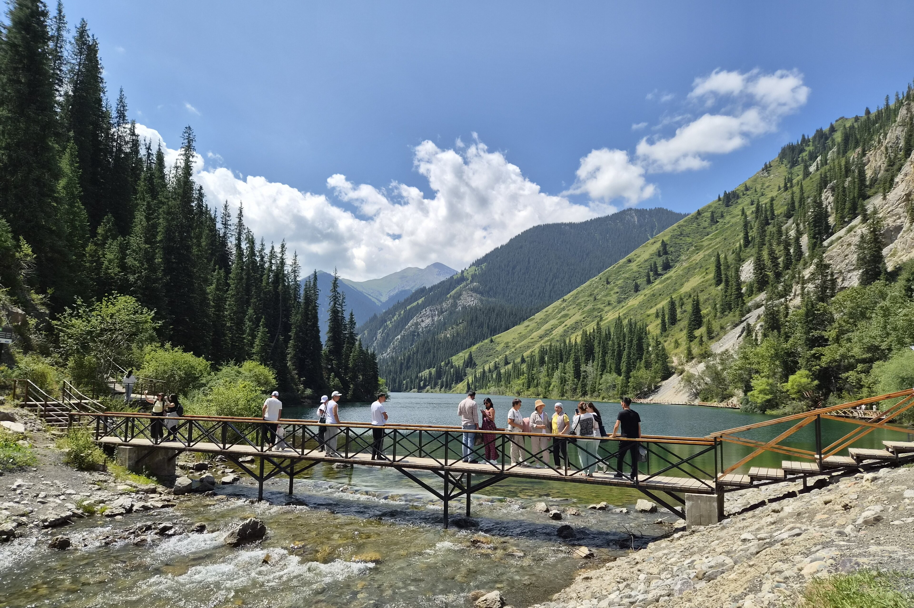
  
  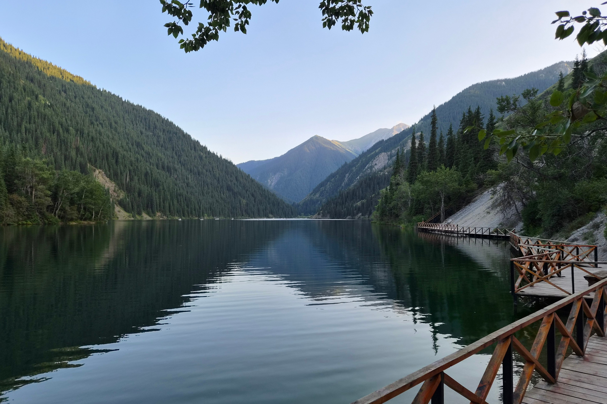
  
  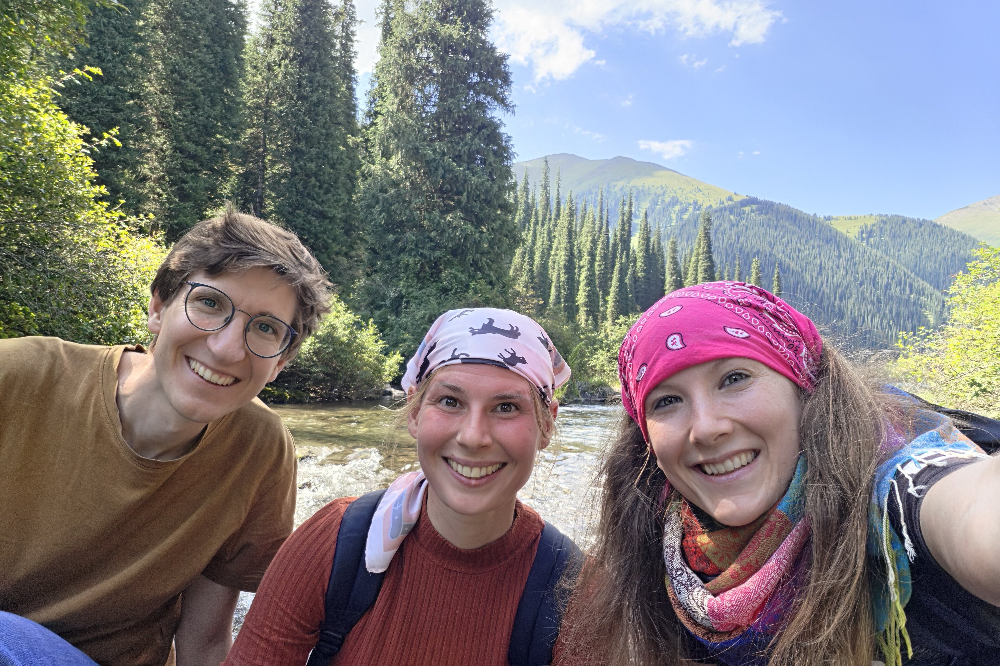
  
  
  
  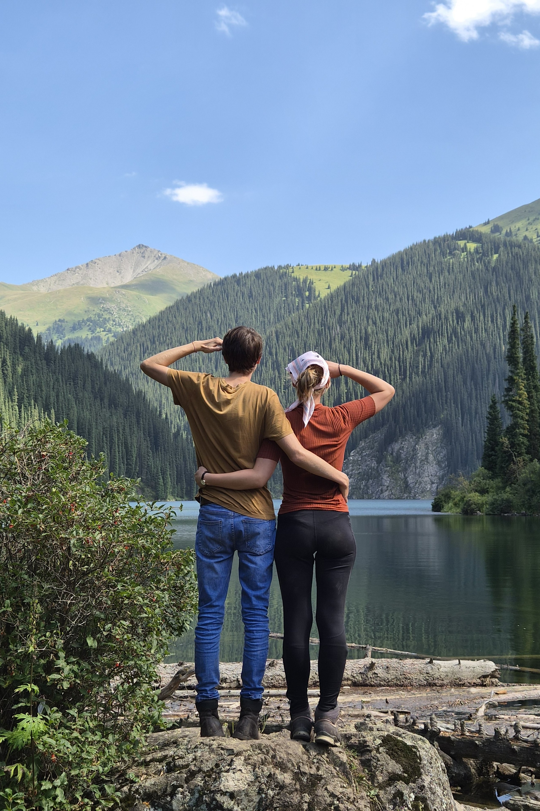
  
  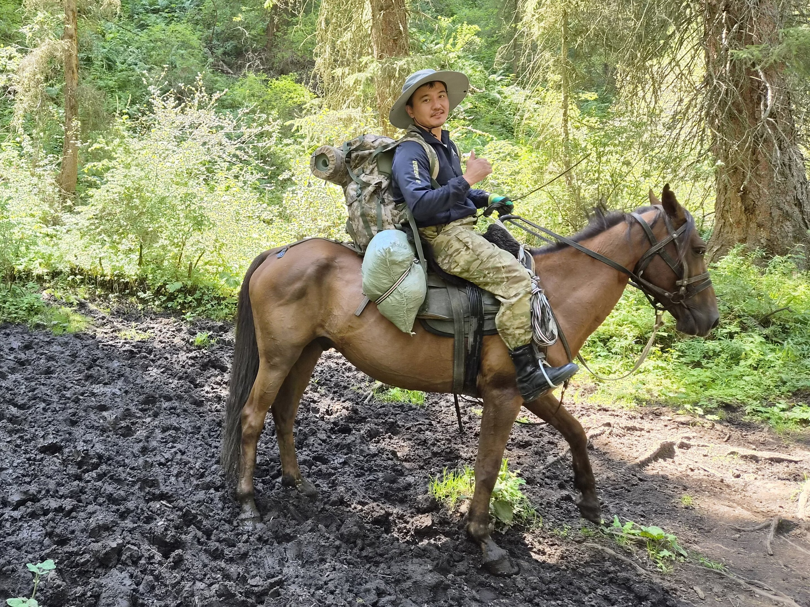
  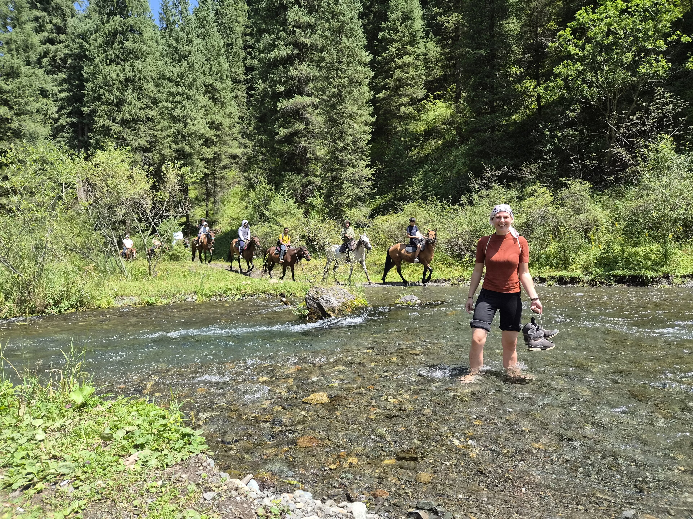


Kaindy Lake erreichten wir am nächsten Tag hingegen weitaus schneller als gedacht. Die Wege in Kasachstan sind weit (v. a. zu Fuß) und insbesondere zum Kaindy Lake auch nichts für schwache Nerven bzw. Autos (eine neue Straße befindet sich bereits im Bau). Wir hatten das Glück, dass uns ein anderer Gast unserer Unterkunft in seinem hochgesetzten 4-Rad-Antrieb mitnahm. Ein kurzer Fußmarsch und da waren sie: die Baumstämme, die sonderbar anmutig aus dem türkisenen Wasser ragen, umsäumt von dunklen Tannen und Bergen. Sehr fotogen.


  
  
  


## Ein Highlight jagt das nächste
Es war noch früh am Tag und so beschlossen wir, das letzte Highlight der Region auch noch aufzusuchen: die Canyons. An die Straße, Daumen hoch und zwei, drei Mitfahrgelegenheiten später sind wir auch schon dort. An der Stelle sei noch einmal die Freundlichkeit der Kasachen erwähnt. Sei es der Fahrer eines alten Klapperkisten-Busses, der die Musik aufdreht und uns über den Buckelpistenabschnitt bis zur Straße unten mitnimmt oder die drei Personen, die uns trotz 5-Sitzer mitnehmen, vorbei an mehreren Polizeikontrollen (bei denen Felix auf dem Kissen im Kofferraum unauffällig abtauchen musste) und uns die nächste Mitfahrgelegenheit bis zum Canyon organisierten.

Charyn Canyon war großartig. Gar nicht zu beschreiben, wie spektakulär die trockene Landschaft wirkt, in der man Schicht für Schicht an Form und Farbe des Gesteins Zeitzeuge eines mehrere Millionen Jahre alten Naturprozesses wird. Wir folgten Fußspuren einen abenteuerlichen Weg hinunter in die Schlucht, wo eine idyllische Oase am Fluss auf uns wartete. Kurz die Füße in den Fluss hängen (baden verboten) und den offiziellen, aber nicht weniger beeindruckenden Weg wieder nach oben. Daumen raus, hop-on, Zwischenstopp bei der Aussichtplattform eines weiteren Canyons, hop-off und wir waren wieder „zu Hause“ und genossen das kasachische Abendessen (einmal Buchweizenfrikadellen mit Bratkartoffeln und einmal hausgemachte Nudeln mit Gemüse, zum Nachtisch selbst gebackenes helles Brot und sehr süße Marmelade, ebenfalls aus eigener Herstellung).


  
  
  
  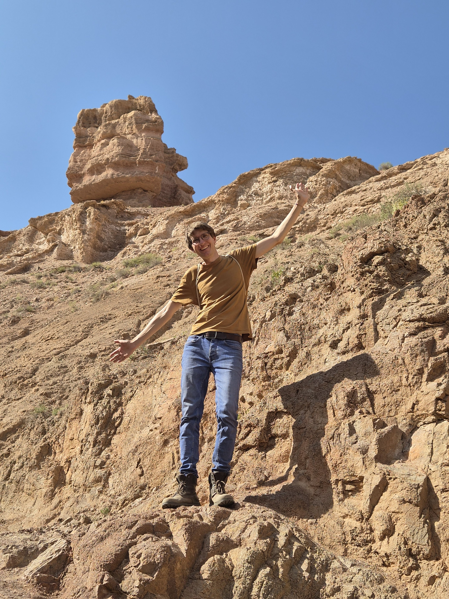
  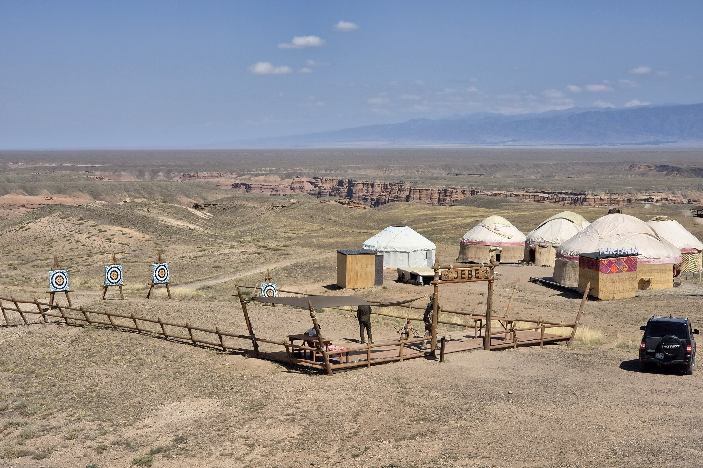
  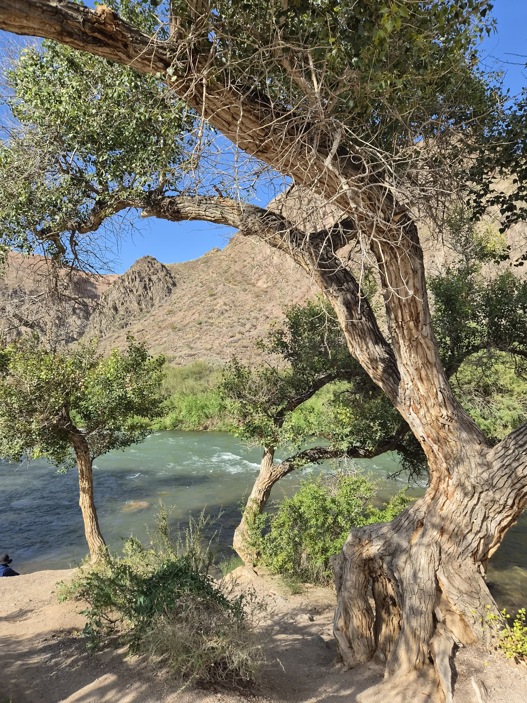
  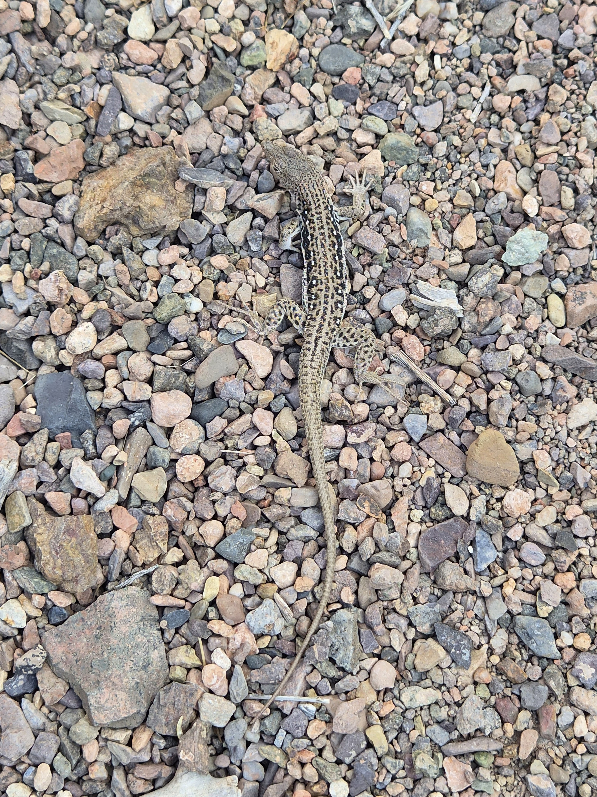
  
  
  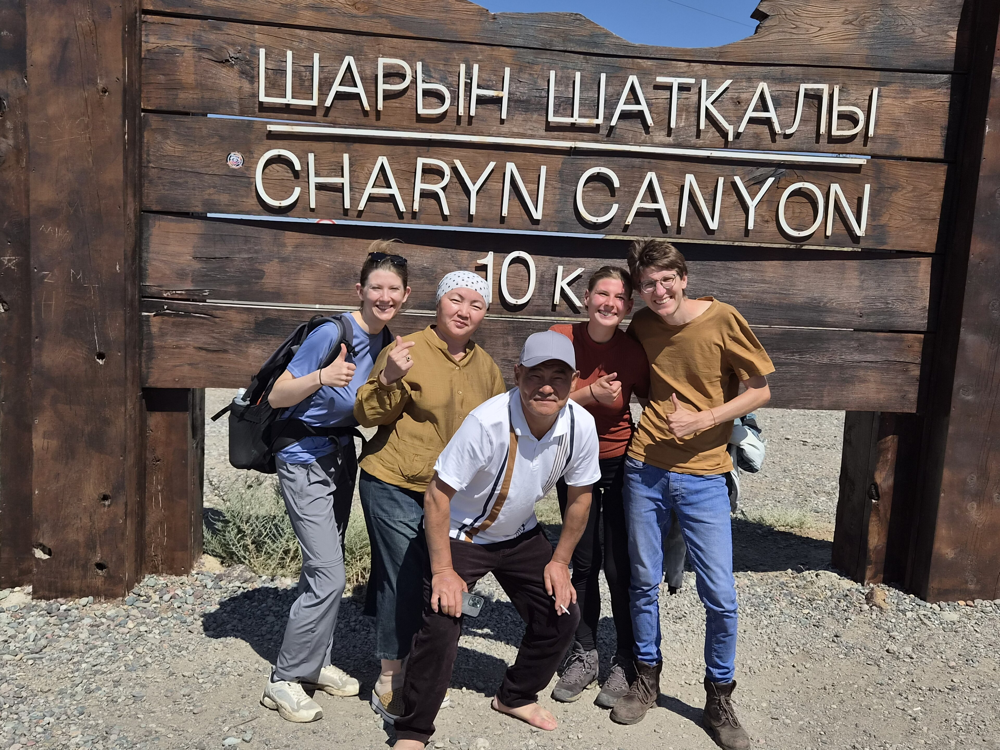
  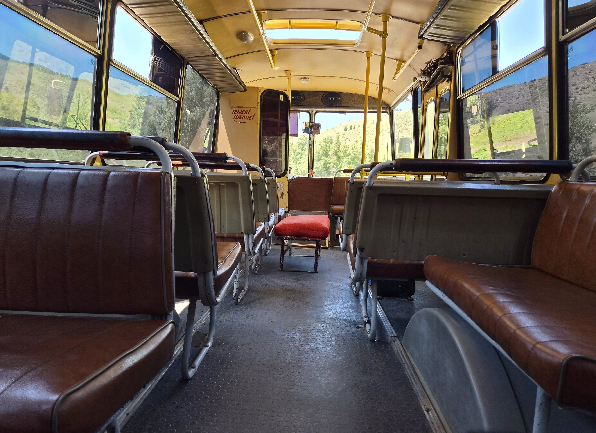
  
  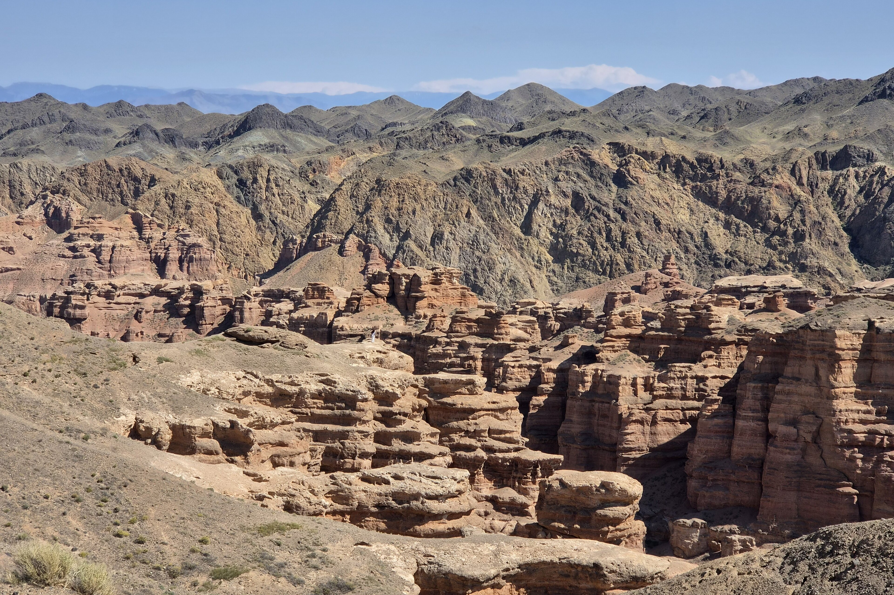


Die Wohnungen sind eher einfach und wirken für uns durch die vielen Mustertapeten und Teppiche ggf. ein wenig altbacken, wenn auch gemütlich. Forderten abends zu viele Zimmer gleichzeitig Strom an, konnte es schonmal sein, dass die Glühbirne nur noch ganz matt glomm. Der Gedanke, dass sie dort zur gleichen Zeit wie wir auf der gleichen Erde leben ist jedes Mal faszinierend, weil es einem teilweise eher vorkommt wie eine Reise in die Vergangenheit.

## Almaty die 2. 
Am nächsten Tag ging es nach dem Frühstück (Spiegeleier, Tomaten und Gurken sowie das Brot und die süßen Marmeladen) mit nur einer Mitfahrgelegenheit wieder zurück in die Stadt. Im Vergleich zur Natur, wo es abends auch mal frisch werden konnte, war es hier wieder ziemlich heiß (über 30°C). Wir genossen die wiedergewonnene Unabhängigkeit und Freiheit einer kleinen Wohnung mit eigener Küche und Bad, gingen in den Markthallen frisches Obst, Gemüse, Eier,… einkaufen und ließen es nach den ereignisreichen Tagen ruhig angehen. Wir waren an einer anderen Ecke der Stadt als zu Beginn unserer gemeinsamen Zeit, entdeckten dadurch nochmal neue Orte und versuchten auch, den ein oder anderen Museumsbesuch zu organisieren. Das ist nicht so leicht, da auch die Museen noch im Aufbau scheinen. Nachdem wir beim Militärmuseum vor verschlossenen Türen standen und aufgrund der ersten Tafeln vor den Türen erahnen konnten, dass die Ausstellung wohl nur auf Kasachisch und Russisch angeboten wurde, probierten wir es am nächsten Tag direkt beim Almaty-Stadtmuseum. Es ist in einem sehr schönen alten Architektenhaus untergebracht und durchaus liebevoll gestaltet. Nur fehlte ein bisschen der Zusammenhang der Exponate bzw. die Einordnung, Erklärung oder Verbindung zur Stadt. Wir waren hinterher um ehrlich zu sein nicht schlauer als zuvor. Doch das passte irgendwie auch wieder zu dieser Stadt, die den Tourismus gerade erst entdeckt und einfach noch im Aufbau steckt; sei es beim Wohnraum, dem öffentlichen Verkehrsnetz oder eben der Museen.


  
  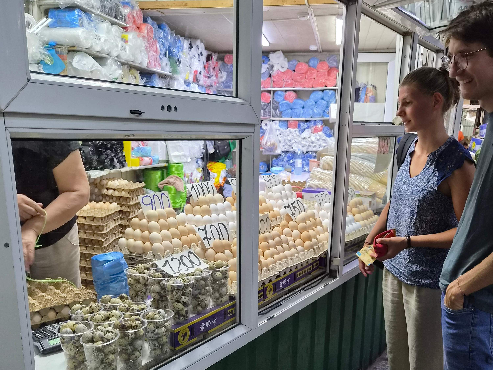
  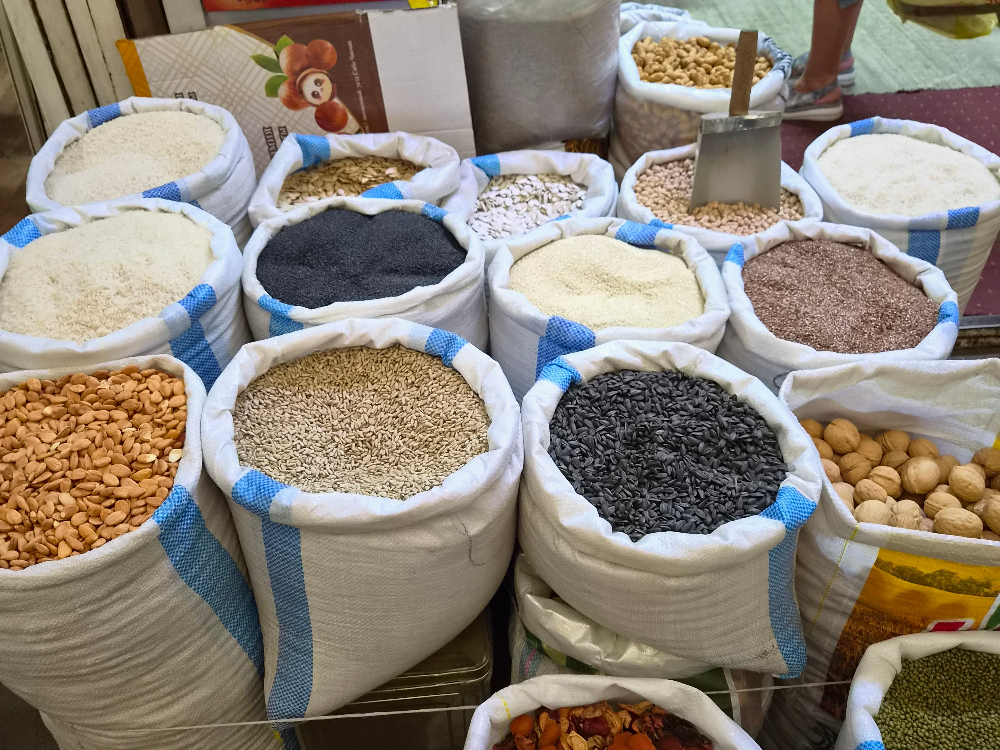
  


Erwähnenswert ist noch das unverhoffte Sommerkonzert vor unserer Haustür, dem wir eines Abends kurz beigewohnt haben und die Rollschuhbahn daneben entdeckten. Sowie unser letzter Ausflug zum „Big Almaty Lake“. Hier hat sich wieder gezeigt, wie weit die Wege in Kasachstan sind. Allein die Anfahrt hat zwei Stunden mit dem öffentlichen Bus gedauert. Die Angaben zur Endhaltestelle und Laufweg bis zum See unterschieden sich bereits im Voraus, sodass wir einfach drauf los sind. Es war ein sehr heißer, sonniger Tag und es ging durch nahezu unberührte Natur steil und lange den Berg hoch, immer höher und höher. Oben angekommen wartete ein gräulicher See, jedoch ohne direkten Zugang. Baden war verboten, da dies die Trinkwasserversorgung der Stadt ist. Die Szenerie außenherum erinnerte mit den steinigen Wegen und hohen Gipfeln an unsere Alpen. Wir gönnten uns eine Pause und mit Käse gefüllte Teigtaschen, bevor es wieder runter ging. Es war bereits früher Abend und die Sonne ging mit der Zeit langsam (aber spektakulär) unter, sodass wir noch ein gutes Stück vor uns hatten als es bereits dunkel war. Wir ließen uns nicht beirren und liefen weiter den Berg hinab, als ein freundliches Auto anhielt und fragte, ob wir eine Mitfahrgelegenheit in die Stadt bräuchten. Perfekt! Auf die Kasachen ist Verlass. 😊 Selbst mit dem Auto brauchten wir noch über 2 Stunden bis wir wieder in Almaty waren, da die Straßen hoffnungslos verstopft sind. Noch einmal duschen, packen, schlafen und dann war sie auch schon vorbei, unsere gemeinsame Zeit in Kasachstan. Einem vielseitigem, noch wenig touristischem Land mit unglaublicher Natur, einer unkompliziert-praktischen Art und sehr herzlichen Menschen.



Ich kann jedem Interessierten nur empfehlen, sich Felix‘ und Sandrines Reise für eine Zeit lang anzuschließen. Neben den schönen gemeinsamen Abenden, vielen Gesprächen und tollen Ausflügen lässt sich schließlich auch von der beeindruckenden Reiseerfahrung, Abenteuerlust und Sprachkenntnis der beiden profitieren. 😉 Herzlichen Dank nochmal Euch beiden, schön war’s! 😊

