Am Morgen ein kurzer, herzlicher Abschied von Sophie, dann noch rasch unsere eigenen Sachen gepackt, und schon waren wir, nur noch zu zweit, wieder unterwegs. Vorerst mit dem gleichen Bus dieselbe Strecke aus Almaty hinaus und ab dem Charyn Canyon dann auf uns noch unbekannten Wegen. Etwas später wand sich die Straße zum Kasachisch-Kigisischen Grenzpass hinauf. Die neuen Stempel im Pass waren schnell ergattert, und eine sanfte Talfahrt schloss sich an. Bald lösten die Schattierungen von Grün der mit Gras bewachsenen Hänge das wüstenhafte Gelb-Braun ab, und wir erreichten die Ebene rund um den _Issuk Kul_, das vor der beeindruckenden Kulisse der Ausläufer des _Tian Shan_ Gebirges gelegen ist.


  


In Karakol, der bedeutendsten Stadt dieses _Oblus_, fanden wir in einem der vielen Blockgebäude unsere Herberge: von außen nicht gerade eine Augenweide, von innen aber eine interessante Mischung aus (für uns) etwas aus der Zeit gefallener Gemütlichkeit und moderner Standards.
Die heimelige Atmosphäre nutzten wir, um uns Gedanken über die nächsten Etappen zu machen, näherte sich, hier auf 1800m Höhe, gefühlt schon ein wenig der Herbst. Natürlich ließen wir es uns aber auch nicht nehmen, bei langen Spaziergängen die vielen Parks dieser angenehm unaufgeregten Stadt zu erkunden, die vielen als Basis für Expeditionen ins Hochgebirge dient.


  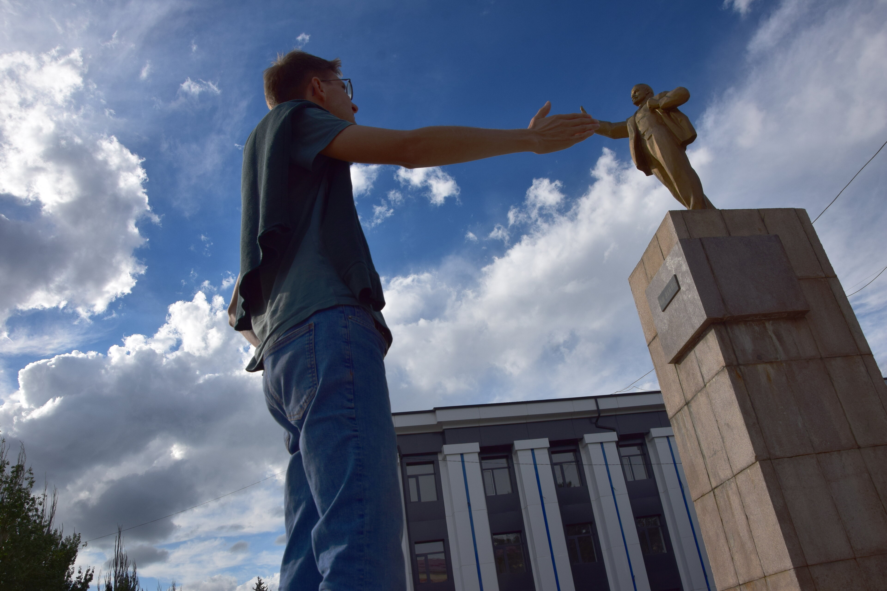
  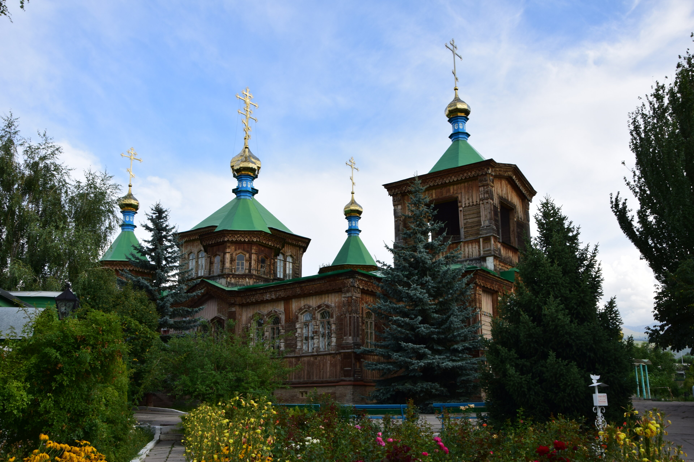
  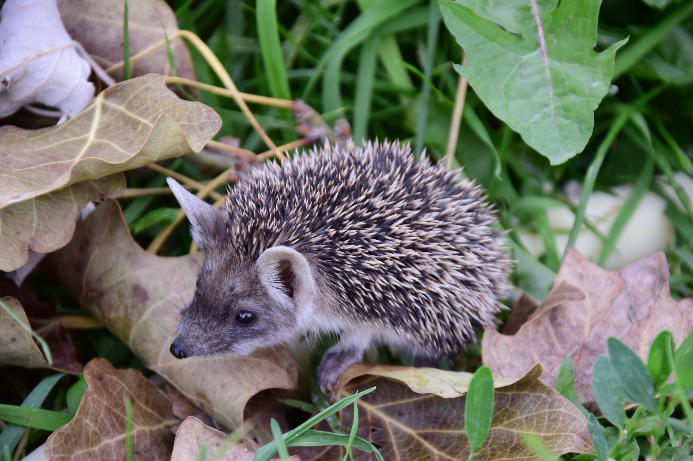
  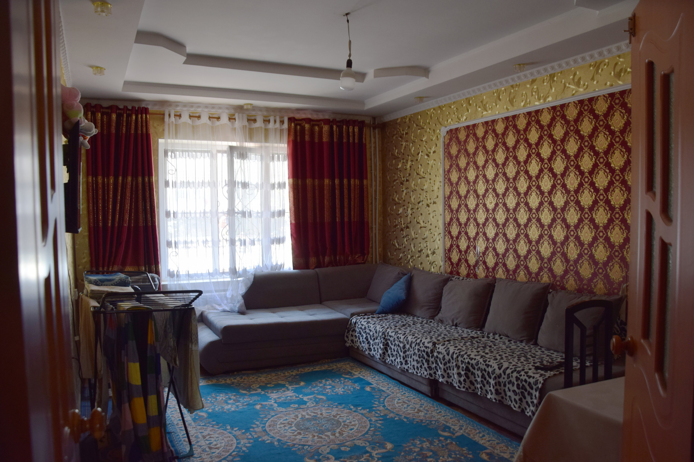
  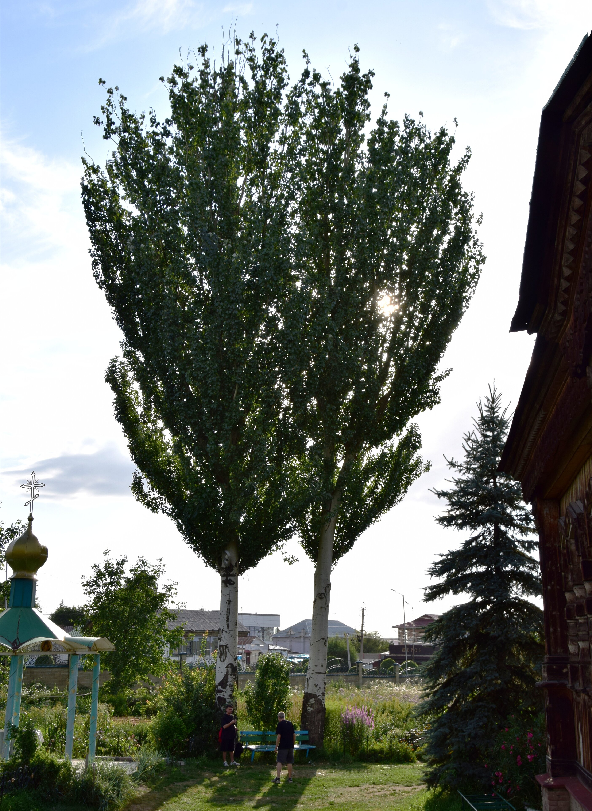
  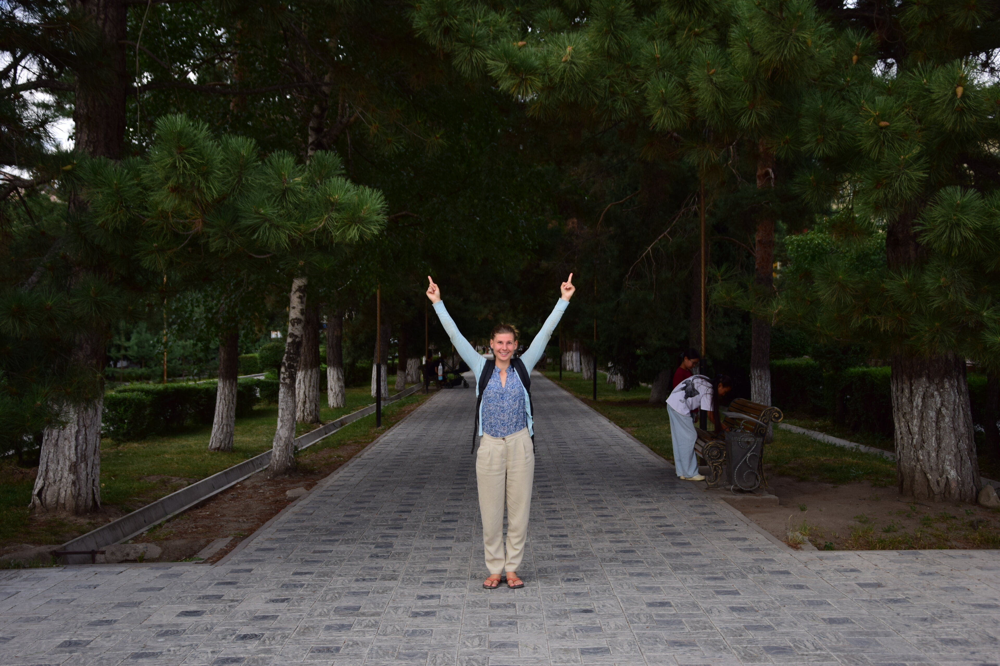
  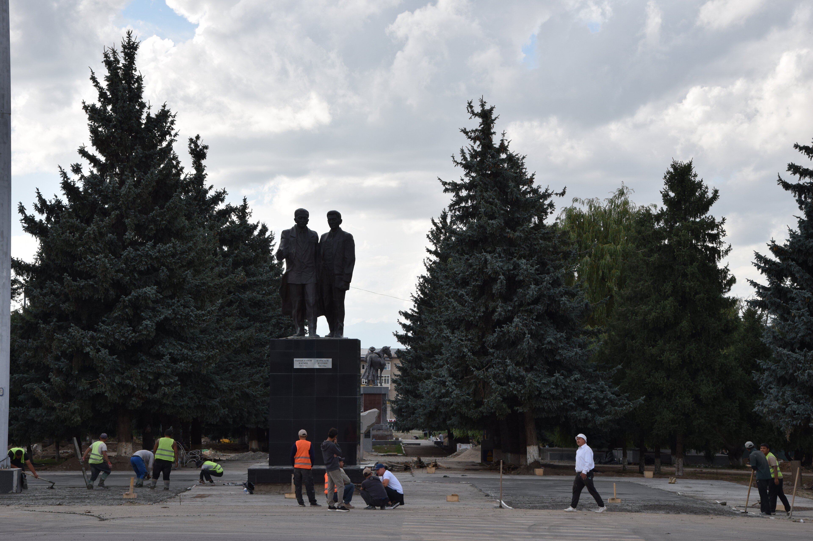
  


## Auf staubigen Straßen zum blauen Wasser
Nach einigem Hin und Her entschlossen wir uns aufgrund der Wetterlage, selbst nicht in die Höhenluft vorzudringen, sondern stattdessen den zweitgrößten Salzsee unseres Planeten über eine südliche, weniger touristische Route zu erkunden. Kaum waren wir aus der Stadt, begann eine staubige Fahrt über schier nicht enden wollende Baustellen, vorbei an chinesisch beschrifteten Baumachinen und definitiv nicht kirgisisch wirkenden Arbeitern.
Ab und an erhaschten wir einen Blick auf das satte Blau des beachtlichen Sees. Diese Ansicht weckte direkt den Wunsch, ins klare Nass einzutauchen. Die letzten Kilometer zu Fuß, auf der Suche nach einem schönen, ruhigen Campingspot am Ufer, steigerten diese Vorfreude nur. Schließlich wurden wir nur wenige Meter vom glasklaren Wasser fündig, setzten unser Gepäck ab, und 🏊. Die Erfrischung war einfach herrlich und brachte Erinnerungen an Sommerabende am _Lac Leman_ zurück. 
Natürlich waren wir zwar im direkten Umfeld alleine für uns, aber sicher nicht die Ersten, die diese Perle entdeckten. Hin und wieder gab es entlang des Ufers kleine Urlaubsresorts und die Kombination von Jurten, türkisblauem Wasser und Bergblick wäre uns zuvor nicht in den Sinn gekommen, ergab aber eine durchweg malerische Szene.


  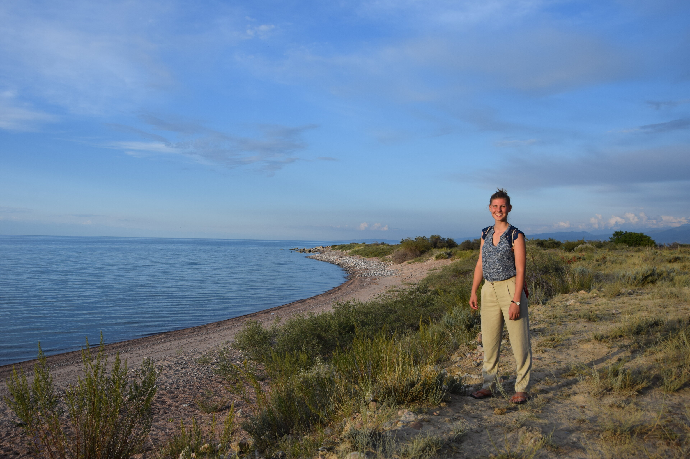
  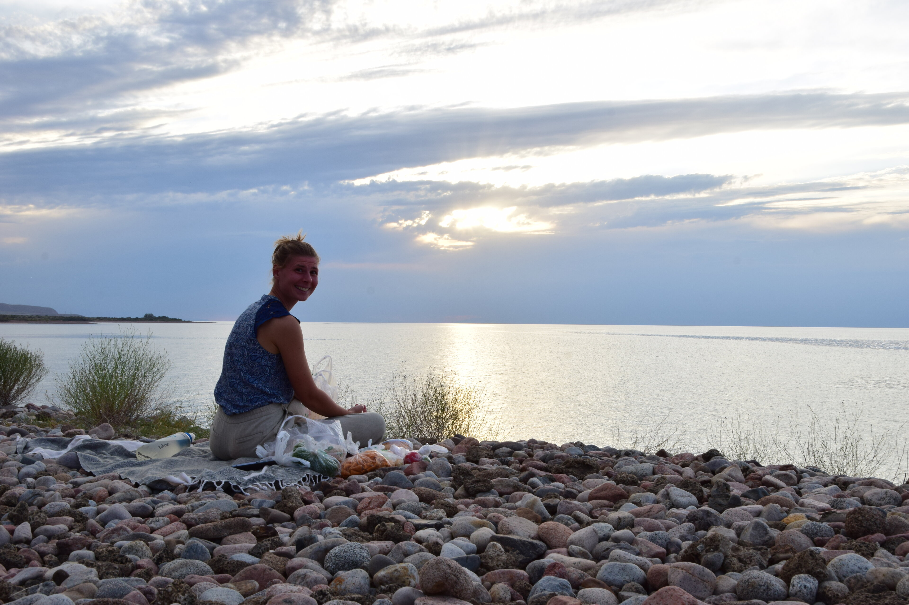
  
  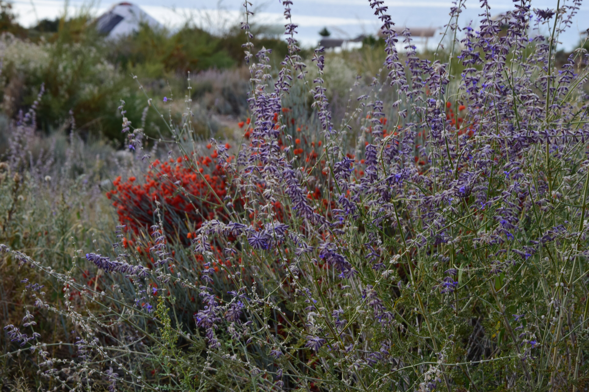
  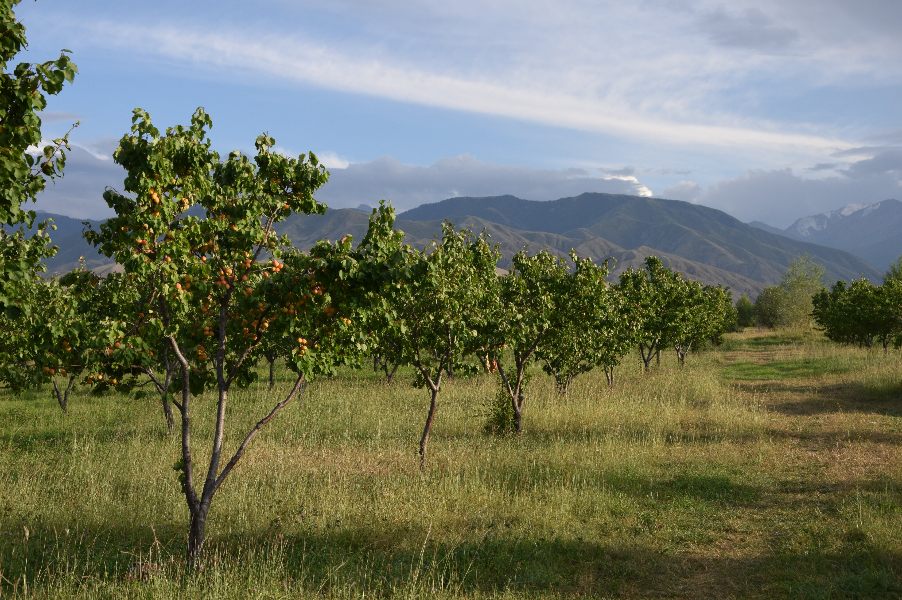
  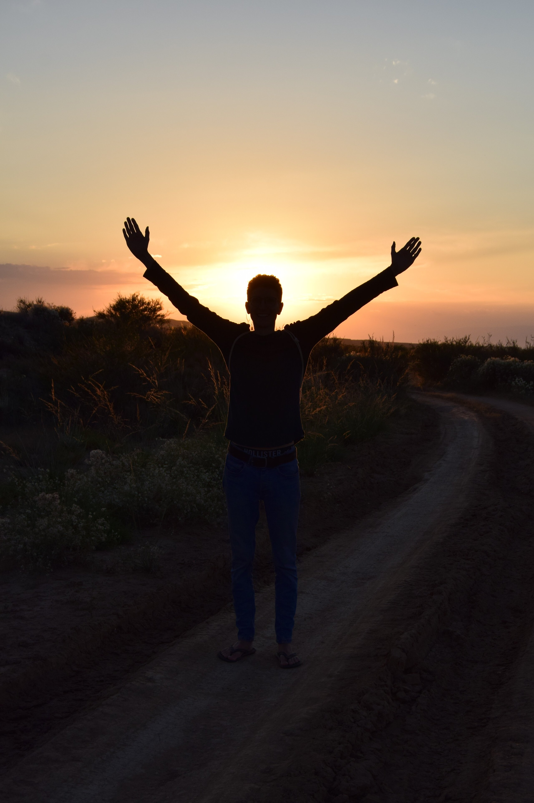
  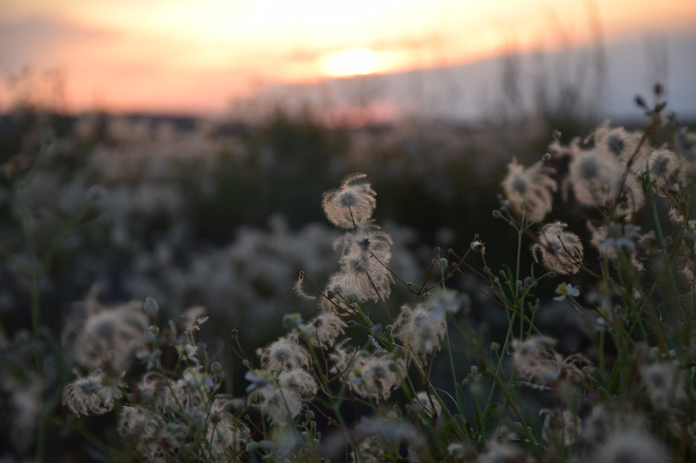
  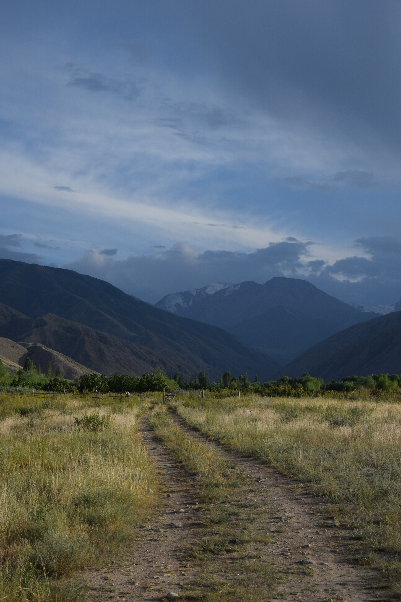
  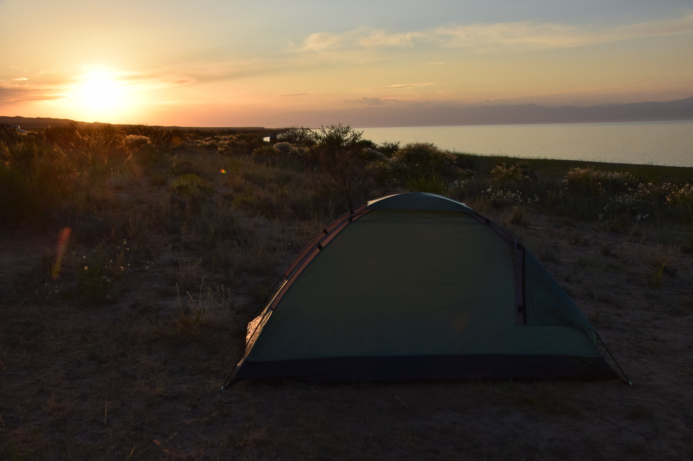
  
  


Am nächsten Tag hatten wir auf dem Weg entlang des Sees die Chance, einige der fabelhaften Steinformationen dieser Region zu bewundern. Dabei überraschte uns doch der touristische Trubel. Insbesondere am _Skazka Canyon_ gab es gleich mehrere Hitchhiker. Wo gibt es denn so was?! Doch die entsprechend vielen Touristen boten auch gute Mitfahrgelegenheiten. So bekamen wir viel zu sehen und kamen zugleich auch gut voran.


__Reisetipp: Ungleiches Tan-Duo__
Usbekistan und Kirgistan sind zwar Nachbarn, haben aber recht Unterschiedliches zu bieten. Während Usbekistan mit Städten in orientalischem Flair lockt, bietet Kirgistan wilde Natur im großen Stil. Eine verlockende Kombination für einen abwechslungsreichen Urlaub.


Der letzte Abschnitt unserer Tagesetappe verlief entlang eines Canyons, groß genug, dass wir mal knapp, mal bequem das ausgetrocknete Flussbett als Straße nutzen konnten. Am anderen Ende fanden wir erneut einen ruhigen Platz zum Campen. Ein Zeltaufbau, ein Bad und eine Tomate-Gurken-Salat Mahlzeit mit Brot später, ließen wir den Tag mit einem Spaziergang bei Sonnenuntergang ausklingen.

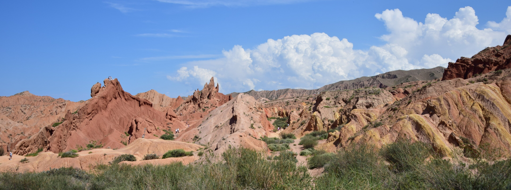

Am nächsten Tag erwachten wir gut erholt, einzig unser Wasservorrat war etwas knapp. Dies hatte mehrere Gründe. Zunächst die generelle Abwägung zwischen nicht zu viel Mehrgewicht und hinreichend Pufferwasser, aber eben auch die nicht ganz einfache Informationslage. Diesmal hatten wir neben Proviant auch darauf gesetzt einem der  die vielen Zuflüsse des Sees etwas Wasser zu entnehmen, allerdings unterschätzt, dass diese zu einem guten Teil ausgetrocknet sind oder zur Bewässerung umgeleitet werden. Auch wussten wir im Vorhinein noch nicht, wo wir genau landen würden. Zu guter Letzt war der See zwar nur sehr leicht salzig, aber zum Trinken wahrscheinlich dennoch zu sehr; also auch keine Hilfe. So kam es nicht ungelegen, als andere Urlauber mit Campingwagen anboten unsere Flaschen wieder aufzufüllen, sie hätten schließlich noch ein paar Hundert Liter und seien selbst auch schon mit Rucksack gereist. Vielen Dank 🙂.

## Bischkek oder doch Paris?
Zwei Mitfahrten durch beeindruckende Landschaften weiter und wir erreichten Bischkek. Die Hauptstadt Kirgistans blieb für uns auffällig unauffällig. Im Zentrum einige moderne Gebäude, große Fahnen, generell recht viele Baustellen, meist ein neu angelegter Park in Reichweite. Vermutlich gut fürs Alltagsleben aber, nach einigen Monaten in Zentralasien, wenig Einmaliges oder Neues. Ein Highlight dann aber doch der lokale Freizeitpark.



So zogen wir bald weiter, um auch den westlichen Teil Kirgistans zu erkunden. Wieder ging es auf schmalen tief eingeschnittenen und kurvigen Bergstraßen hinauf, bis wir über einen unbeleuchteten, von dicken Abgasen milchig getrübten Tunnel den Grat erreichten. Danach folgte ein breites Tal in dem wir [Paris](https://www.france24.com/en/live-news/20250204-paris-the-village-of-light-in-kyrgyzstan-s-rugged-mountains), den Eiffelturm(!), reichlich Pferde und alles, was ein kirgisisches 100-Seelen-Dorf noch so zu bieten hat, antrafen.

## Landleben abseits der Moderne
Am Abend erreichten wir _Torkent_, ein kleines Dorf am Rande des zum _Toktogul Reservoir_ aufgestauten _Naryn_ Flusses. Obwohl sich Natur und Berge nicht im Wesentlichen von andern Orten Kirgistans unterscheiden, sind Moderne und auch Touristen kaum bis hier vorgedrungen. Unsere Unterkunft war ein Ein-Raum-Nebengebäude eines Gehöfts, wahrscheinlich das frühere Haupthaus. Hier schliefen wir auf einem traditionellen Bettenlager, bestehend aus einer Art _schweren Decke_, die zum Schlafen in der Mitte des Zimmers auf dem Boden  ausgelegt wird. Unsere Gastfamilie, die ausschließlich Kirgisisch sprach, schlug während der Sommermonate ihr Schlaflager auf einer _Teeplattform_ im Freien auf. Fürs private Geschäft gab es eine extra Hütte mit Loch zur Kaverne im Untergrund: 3 ... 2 ... 1 ... platsch 💩. Dann gab es noch eine Scheune, welche bis zum letzten Winkel mit Heu gefüllt war. Die Grundlage allen Lebens in dieser rauen Gegend.



Wir hatten einen Tag für Erkundungen eingeplant und machten uns entlang des _Torkent_ zum Stausee auf. Es stellte sich allerdings heraus, dass dessen Pegel aktuell leider nicht ausreichte um den See bis zu uns zu füllen. Statt des satten Blaus blieb nur ein immerhin reißender Strom. Daher zogen wir es vor, uns direkt im kleineren _Torkent_ abzukühlen. Am späteren Nachmittag, zurück im losen Verbund des Dorfes, fanden wir die _offizielle_ Badestelle des Ortes. Hier wurde das Wasser durch quer zum Fluss aufgeschichtete Steinwälle verlangsamt und viele Familien gönnten sich ein abendliches Bad. Bald waren wir von einigen neugierigen Kindern umringt, welche viele Fragen hatten. Da sie in der Schule sowohl Russisch als auch Englisch lernen, konnten wir uns einigermaßen verständigen und standen Rede und Antwort. Schließlich hatten einige von ihnen noch nie Ausländer gesehen und wir noch nicht viel Gelegenheit gehabt, die Welt aus kirgisischer Sicht zu sehen. 


  
  
  
  
  


Unsere nächste Etappe führte entlang des mächtigen Naryn Flusses, der auch Usbekistan mit Wasser versorgt. Vor allem erstaunte uns auch die Vielzahl der Fischzuchten, die anhand ihrer kreisrunden Flächen im Fluss erkennbar waren. Einen Campingstopp in den Bergen später erreichten wir Osch, eine weitere Stadt der Seidenstraße, sowie muslimisches Zentrum Kirgistans. Die Region um Osch, genauer das _Fergana_ Tal, ist eine geopolitisch heikle Zone. Die Grenzen von Tadschikistan, Kirgistan und Usbekistan bilden hier ein schwer zu durchdringendes Mosaik, reich an Ex- und Enklaven. Die Grenzen wurden während der Sowjetzeit (neu) gezogen und beruhen wohl auf ethnischen Überlegungen. Allerdings wurden auch diese nach Aufständen verschoben. Dies alles wirkt bis heute nach und birgt reichlich Sprengstoff für Konflikte. Zurzeit war es zum Glück friedlich und so konnten wir unbekümmert Osch erkunden. Erneut mit Eifelturm!


  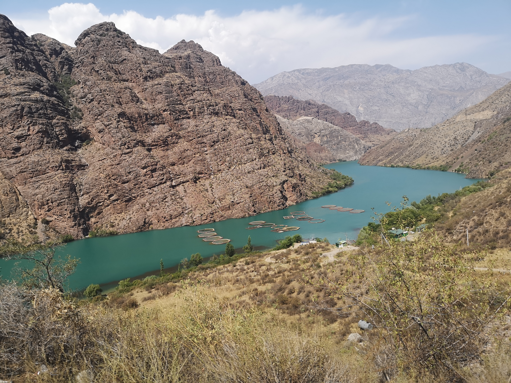
  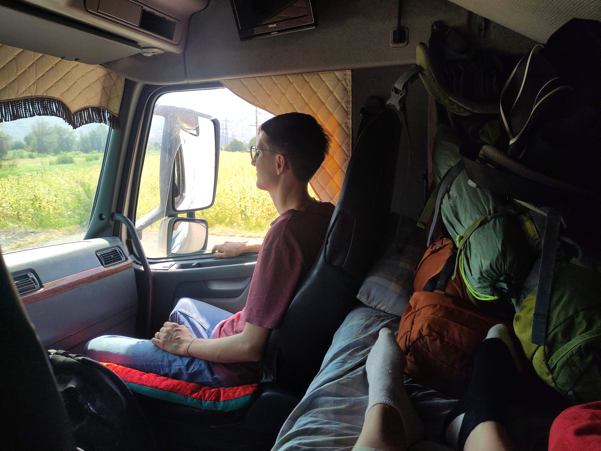
  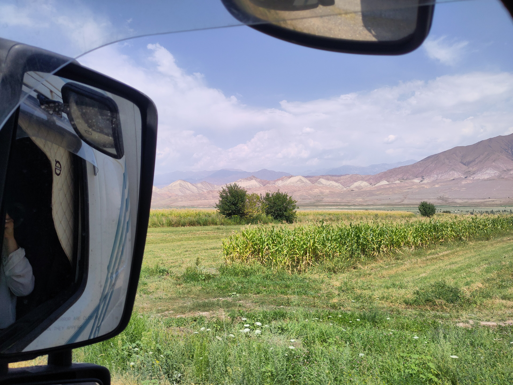
  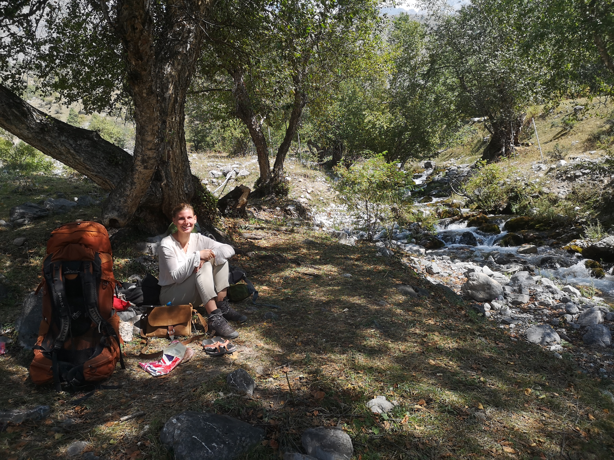


Diese letzte Station war ziemlich repräsentativ für den Gesamteindruck, den Kirgistan bei uns hinterließ. Inmitten atemberaubender Berge, Seen, Gletscher, Canyons und Pferde, lebt es sich unaufgeregt. Die Moderne kommt in Form von Bauprojekten, geplant und unterstützt aus China, umgesetzt von Gastarbeitern aus Pakistan oder Bangladesch. Entsprechend gibt es in den Städten eine gute Mischung aus neu und alt. Die Meinung der Bevölkerung zur _Entwicklungshilfe_ des großen Nachbarn war durchaus differenziert: _“Immerhin gibt es etwas Neues, aber die damit verbundene Abhängigkeit ist zumindest problematisch“_. Wahrscheinlich stimmen beide Aspekte. Auf jeden Fall war dieses Thema sehr präsent. Nicht nur weil unsere Fahrzeuge kilometerlange Tunnel in den Staub der Baustellen bohrten, sondern auch weil, ohne unser Zutun, jeder Einwohner dieses Thema adressierte.


  
  
  
  
  
  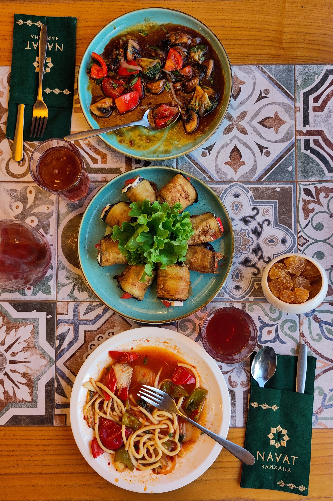


Die Unabhängigkeit und eigene Identität scheint generell einen wichtigen, aber nicht überhöhten, Stellenwert in der Bevölkerung einzunehmen. So gibt es ein großes Bewusstsein für die kulturelle Herkunft. Zum Beispiel hat es die Jurte - oder genauer: der/die/das _Tündük_, die zentrale Öffnung im Dach der Jurte - sogar ins Zentrum der Flagge geschafft und jährlich finden kulturelle Veranstaltungen rund um die Nomaden-Traditionen statt, z.B. die World-Nomad-Games. Eine Erwähnung am Rande ist vielleicht auch die 3-Somoni-Münze wert, eine echte Neuheit auf unserer Reise. 😉 


  
  
  
  
  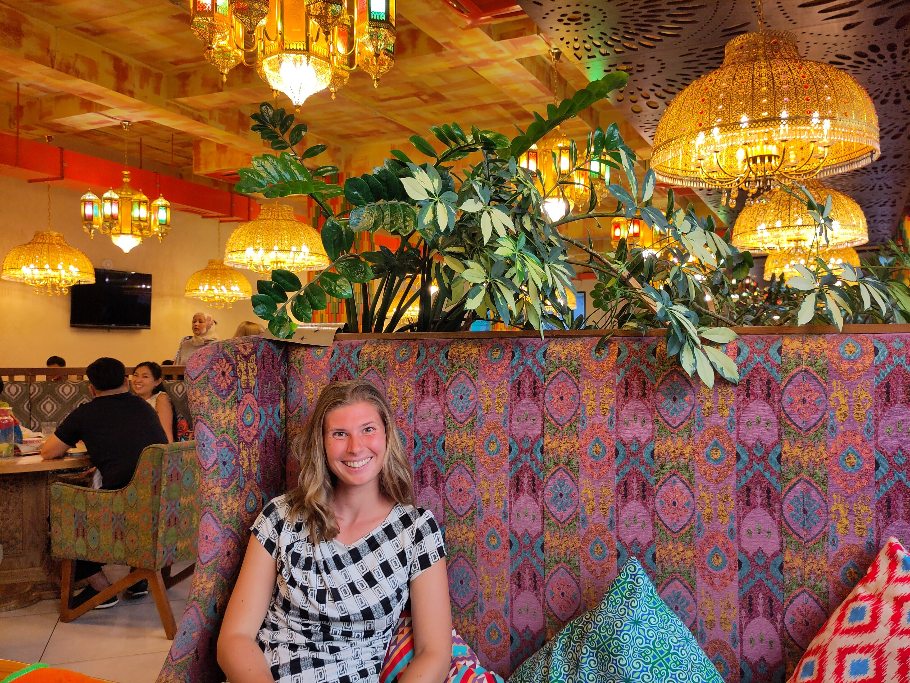
  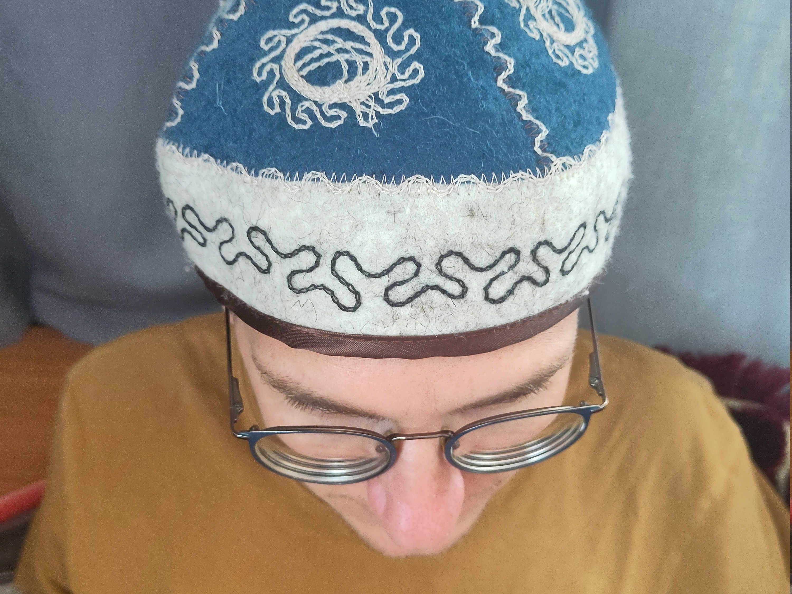


