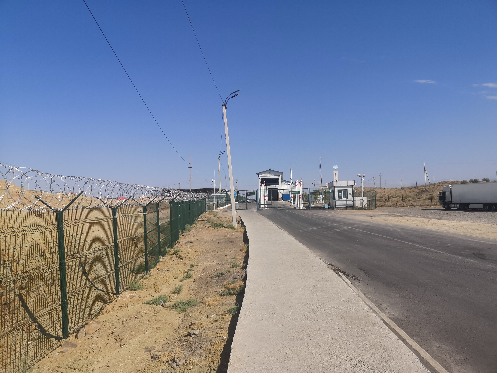
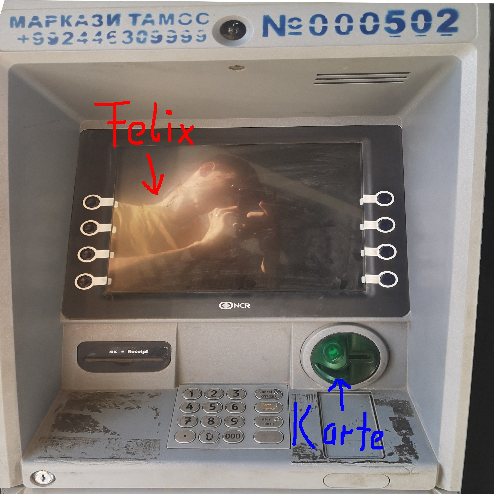

Ein schöner sonniger Morgen, wie gemacht, um uns zum Bleiben zu verleiten. Doch es war an der Zeit das Land zu wechseln und Kirgistan zu verlassen. Nicht, weil es uns nicht gefallen hätte oder etwas schiefgelaufen wäre. Sondern einfach dem Gefühl folgend, vorerst genug gesehen zu haben. Doch so einfach wollte uns Kirgistan dann doch nicht ziehen lassen, denn der Stadtbus, der uns in Osch zum Busbahnhof bringen sollte, wollte leider nicht auftauchen; ein wiederkehrendes Problem, mit dem unsere Beine inzwischen umzugehen wussten. Später am Busbahnhof angekommen als erwartet, blieb dann immerhin Zeit für ein ausgiebiges Gespräch mit einem Herrn, bevor der nächste Bus mit uns gen Westen von dannen zog.

## Reise durchs Niemandsland
In Batken, dem letzten Dorf vor der Grenze, glich sich unser Glückskonto wieder aus: Wir wurden rasch bis zur Grenze mitgenommen und auch die Grenze selbst passierten wir problemlos. Nur die ausgedehnte _Neutrale Zone_ zwischen den Grenzposten überraschte uns ein wenig. Aber, hey, wer hat schon etwas gegen ein kleines Niemandsland als Zugabe, ein Stück Weg und Zeit, sich vom Zurückgelassenen zu verabschieden und auf’s Kommende vorzubereiten?

Geschafft, 17 Uhr, wir hatten Tadschikistan erreicht. Mit einigen Kirgisischen _Somoni_ war der Bus bis zum nächsten Städtchen Isfara gesichert. Dort angekommen, standen wir da, im auslaufenden Getümmel des angrenzenden Basars und mussten uns erst einmal neu sortieren. Unsere suchenden Blicke sprachen scheinbar Bände, denn bald boten uns zwei Frauen ihre Hilfe an. Dankbar holten wir unser ungelenkes Russisch hervor, doch unsere internen Sandrine-Felix-Kurzabstimmungen auf Deutsch waren Hinweis genug: Die ältere der beiden Frauen wechselte unmittelbar auf nahezu perfektes Deutsch. Sie war Deutschlehrerin und die Situation fühlte sich direkt etwas einfacher an. Der letzte Bus nach Khujand, unserer lose geplanten Destination, sollte in etwa 30 Minuten losfahren: genug Zeit um 1. Geld zu besorgen und 2. eine Pinkelpause einzulegen.

## Gastauftritt Bankkarte
Ersteres stellte sich allerdings als herausfordernder heraus als gedacht. Obwohl die Grenze nur wenige Kilometer entfernt war, gab es keinen offiziellen Währungsumtausch zwischen den gleichnamigen Währungen, weder bei Banken noch bei Wechselstuben. Und wie das in solchen Situationen nun mal so ist, greift je knapper die Zeit natürlich umso eher Murphy’s Gesetz. So auch hier: Die Zeit drängte, der Bankautomat rief, die Karte verschwand in dessen leuchtenden Schlitz und wir warteten auf ein Zeichen. Doch nichts passierte. Der Bildschirm blieb schwarz, kein Tastendruck half, die Karte war weg. Nach ein paar Minuten des perplexen, rhetorischen _Menno, das könnt ihr Fieslinge doch nicht machen!_, schalteten wir in Aktionsmodus. Eine Filiale der Automatenbetreiberbank lag zum Glück direkt auf der anderen Straßenseite. Dem hilfsbereiten Sicherheitsbeamten konnten wir unsere Lage erstaunlich schnell erklären. Mit einer gewissen Routine, meinte er, der Automat werde im Laufe des Abends wieder aufgefüllt. Wenn wir warten, bekämen wir dann unsere Karte wieder zurück.

Endlich also Zeit für die mehrfach aufgeschobene Pinkelpause. Und auch für einen erneuten Versuch, die restlichen kirgisischen Somoni loszuwerden: Wenn nicht hier, wo dann? Auch wenn man diese, wie mancher zurecht einwenden mag, doch immer mal gebrauchen kann! Nach einigem Durchfragen im Basar fanden wir schließlich eine wechselwillige Person und hatten bald zumindest die richtige Währung in der Tasche.

Mit dieser neu gewonnenen Sicherheit hatten wir gerade wieder unseren Posten vor der Bankfiliale bezogen, da kam tatsächlich schon ein Geldtransporter. Wenig später waren wir wieder mit unserer Karte vereint. Bloß, der Bus war bereits weg.

## Weiter geht's
Zwei Optionen boten sich an: Vor Ort etwas suchen oder direkt die _Hitchhikability_ Tadschikistans auf die Probe stellen. Warum nicht eine Kombi? Wir beschlossen einfach in Richtung der passenden Straße zu starten, gleich auch schon vorbei an einer riesigen Flagge, und überließen es dem Zufall, ob wir erst eine Unterkunft oder einen _Chauffeur_ finden würden. Bei Abenddämmerung gewann ein freundlicher BMW-Fahrer die Challenge. Er hatte in China studiert und gearbeitet, und sah in uns eine gute Gelegenheit sein Englisch zu verbessern. Eine kurzweilige Fahrt später ließ er uns nicht ohne ein gemeinsames Abendessen gehen. Unser Versuch, dieses wenigstens mit unserer wiedererlangten Karte zu bezahlen, wurde von seinen aufmerksamen Freunden vereitelt. Noch keine sechs Stunden in Tadschikistan hatten wir uns bereits zweifach von der Gastfreundschaft dieses Landes überzeugen und ein paar typische Speisen probieren können. Wir wissen, was wir an dieser spontanen Reiseart schätzen. Doch die Kehrseite dieser Medaille, eine gewisse Kleinigkeit von läppischen 80 km, die es noch zurückzulegen galt, wartete noch auf uns. Vom leckeren Essen und der heiteren Atmosphäre noch ganz beschwingt, störte es uns nicht, mittlerweile bei Dunkelheit, wieder an der Straße zu stehen, denn von einer Herberge war keine Spur zu sehen.

## Ein süßes Ende
Diesmal brauchte es ein paar Anläufe sowie ein langes Abwimmelgespräch mit einem deutlich zu betrunkenen Herrn, bevor wir letztlich erfolgreich eine Mitfahrt nach Khujand aushandeln konnten. Offenbar waren wir dabei nicht präzise genug und wurden noch etwas 10 km außerhalb des Stadtzentrums abgesetzt. Eine dritte Mitfahrgelegenheit brachte uns dann direkt ins Zentrum und lehnte alle Zahlungsangebote, obwohl Uber-Equivalent von Beruf, _partout_ ab. Es war spät und eine Unterkunft hatten wir noch immer nicht. Doch kaum waren wir aus dem Auto ausgestiegen, sprach uns ein gut gelaunter stolzer Besitzer zweier Honigmelonen an. Er kenne ein vernünftiges, günstiges Hostel. Wir hatten ein gutes Bauchgefühl und schlossen uns ihm an. Kurze Zeit später, mittlerweile Mitternacht, waren wir vor Ort. Einmal ans richtige Fenster geklopft, bekamen wir Einlass und auch zwei Betten. Immerhin konnten wir verhindern als Zugabe noch _beide_ Melonen geschenkt zu bekommen und einigten uns auf halb-halb.

So hatten wir bereits an unserem ersten halben Tag in Tadschikistan eine Menge erlebt; auf Hoch folgte Tief und _vice versa_. Aber Ende gut, alles gut, wozu sind wir schließlich unterwegs?
